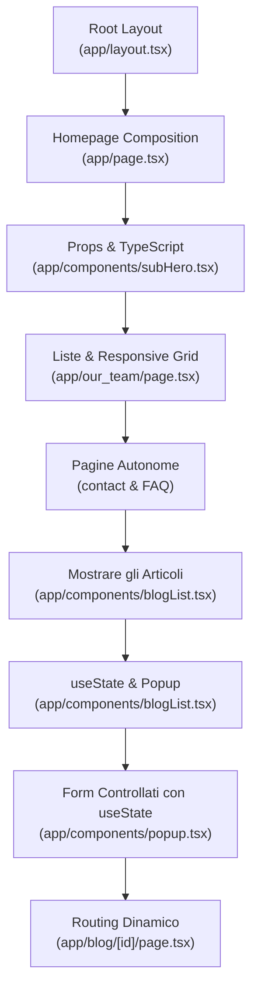

# 🎓 Pacchetto Formazioni Frontend — JEMORE

Benvenuto nel progetto formativo di sviluppo Frontend con **Next.js 15**, **React 19**, **TypeScript** e **Tailwind CSS v4**.

Questo repository è strutturato come un **percorso pratico guidato**: i file sorgente contengono commenti `// TODO: ...` che indicano cosa implementare, i concetti chiave e i suggerimenti di codice.

---

## 🚀 Come avviare il progetto

1. **Installa le dipendenze** (se non l'hai già fatto):
   ```bash
   npm install
   ```

2. **Avvia il server di sviluppo**:
   ```bash
   npm run dev
   ```

3. **Apri il browser**:
   Visita [http://localhost:3000](http://localhost:3000) per vedere l'applicazione in tempo reale.

---

## 🗺️ Moduli Didattici



---

### Il Layout Globale
📁 **File**: `app/layout.tsx`  
🎯 **Obiettivo**: Capire come Next.js App Router racchiude tutte le pagine dell'applicazione.
* Inserisci `<Header />` sopra `{children}`.
* Mantieni `{children}` al centro: è qui che Next.js monta la pagina corrente in base all'URL.
* Inserisci `<Footer />` sotto `{children}`.
> **Concetto chiave**: I componenti inseriti nel `RootLayout` rimangono persistenti e non vengono ricaricati durante la navigazione.

---

### Composizione della Homepage
📁 **File**: `app/page.tsx`  
🎯 **Obiettivo**: Assemblare una pagina componendo più componenti riutilizzabili.
* Importa e monta `<Hero />`, passando le props `title` e `subtitle`.
* Importa e monta due componenti `<SubHero />`, passando `title` e `content`.
* Esempio:
  ```tsx
  <Hero title="Benvenuto nel mio sito!" subtitle="Scopri i nostri fantastici prodotti." />
  <SubHero title="Perché sceglierci?" content="Offriamo soluzioni innovative su misura." />
  ```

---

### Componenti con Props in TypeScript
📁 **File**: `app/components/hero.tsx` e `app/components/subHero.tsx`  
🎯 **Obiettivo**: Comprendere il passaggio dei dati (props) e la tipizzazione statica con TypeScript.
* Definisci l'interfaccia:
  ```typescript
  interface SubHeroProps {
    title: string;
    content: string;
  }
  ```
* Accetta le props nel componente: `const SubHero: React.FC<SubHeroProps> = ({ title, content }) => { ... }`.
* Renderizza i valori dinamici all'interno dei tag JSX: `<h2>{title}</h2>` e `<p>{content}</p>`.

---

### Liste e Griglie Responsive con Tailwind
📁 **File**: `app/our_team/page.tsx` *(dati in `app/utils/team_members.tsx`)*  
🎯 **Obiettivo**: Mappare array di oggetti in elementi JSX e utilizzare la griglia responsive di Tailwind CSS.
* Importa l'array `teamMembers` da `../utils/team_members`.
* Usa `.map()` per iterare sui membri:
  ```tsx
  {teamMembers.map((member) => (
    <div key={member.name} className="border p-4">
      <h2 className="text-xl font-medium text-blue-300">{member.name}</h2>
      <p className="text-gray-500 text-sm mb-2">{member.role}</p>
      <p className="text-gray-600 text-sm">{member.bio}</p>
    </div>
  ))}
  ```
* **Perché serve la prop `key`?** React ha bisogno di una chiave univoca per identificare ogni elemento della lista e aggiornare in modo efficiente solo gli elementi che cambiano.

---

### Creare Nuove Pagine (Routing basato su cartelle)
📁 **File**: `app/contact/page.tsx` e `app/FAQ/page.tsx`  
🎯 **Obiettivo**: Creare pagine da zero sfruttando la convenzione di Next.js: ogni cartella in `app/` con un file `page.tsx` diventa una rotta (`/contact`, `/FAQ`).
* **Contact**: Inserisci le informazioni dell'ufficio (indirizzo, email, orari) o crea un modulo di contatto.
* **FAQ**: Mostra una serie di domande e risposte frequenti (bonus: usa un array di oggetti e `.map()`).

---

### Mostrare gli Articoli del Blog
📁 **File**: `app/components/blogList.tsx` *(dati in `app/utils/posts.tsx`)*  
🎯 **Obiettivo**: Mostrare la lista degli articoli prima di aggiungere interattività.
* Importa `posts` da `../utils/posts`.
* Mostra ogni post dentro un `<Link href={`/blog/${post.id}`}>`.
* Mostra `post.title` e un'anteprima del testo con `post.content.slice(0, 70)`.

---

### Capire e Padroneggiare `useState`: Il Popup
📁 **File**: `app/components/blogList.tsx`  
🎯 **Obiettivo**: Capire perché serve `useState` e come funziona la reattività in React.

#### ❓ Perché una normale variabile non funziona?
Se scrivessimo:
```javascript
let showPopup = false;
// al click:
showPopup = true; // ❌ Il valore cambia in memoria, ma React NON lo sa e non aggiorna lo schermo!
```
In React, per modificare ciò che l'utente vede a schermo serve uno **Stato Reattivo**.

#### 💡 Come funziona `useState`:
```typescript
const [showPopup, setShowPopup] = useState(false);
```
1. `showPopup`: la variabile che contiene il valore corrente letto dal componente.
2. `setShowPopup`: l'unica funzione che può cambiare il valore e **notificare a React di ri-eseguire il componente (re-render)** con il nuovo stato.

#### 🛠️ Implementazione:
* Aggiungi il pulsante: `<button onClick={() => setShowPopup(true)}>Add post</button>`.
* Rendering condizionale: `{showPopup && <Popup onClose={() => setShowPopup(false)} />}`.
* Passa la callback `onClose`: permette al componente figlio (`Popup`) di chiedere al genitore (`BlogList`) di chiudersi, reimpostando lo stato a `false`.

---

### `useState` per i Form Controllati (Two-Way Binding)
📁 **File**: `app/components/popup.tsx`  
🎯 **Obiettivo**: Gestire gli input utente con componenti controllati.

* **In HTML tradizionale**: un input gestisce il testo internamente nel browser.
* **In React (Controlled Component)**: React è la "Single Source of Truth". L'input legge il valore dallo stato e lo aggiorna a ogni tasto premuto:
  ```tsx
  const [title, setTitle] = useState("");

  <input
    type="text"
    value={title} // 1. READ: l'input riflette sempre lo stato
    onChange={(e) => setTitle(e.target.value)} // 2. WRITE: ogni tasto aggiorna lo stato
  />
  ```
* Nel gestore `handleSubmit`:
  1. Blocca il refresh della pagina: `e.preventDefault()`.
  2. Resetta gli stati: `setTitle("")`, `setContent("")`.
  3. Chiudi il modale: `onClose()`.

---

### Routing Dinamico & Parametri URL
📁 **File**: `app/blog/[id]/page.tsx`  
🎯 **Obiettivo**: Creare una pagina di dettaglio dinamica che risponde a `/blog/1`, `/blog/2`, ecc.

* La cartella `[id]` definisce un parametro dinamico.
* In Next.js 15, `params` è una Promise. Nel Client Component si estrae con l'hook `use()`:
  ```typescript
  const { id } = use(params);
  ```
* Trova il post corrispondente:
  ```typescript
  const post = posts.find((a) => a.id === parseInt(id));
  ```
* Gestisci il caso in cui il post non esista (`if (!post)`): mostra un messaggio 404 e il link per tornare indietro.
* Aggiungi i bottoni di eliminazione (simulata con redirect) e modifica (apertura del popup).

---

## 💡 Trucchi & Best Practice

| Concetto | Regola d'oro |
|---|---|
| **Client Components** | Inserisci sempre `"use client";` in cima ai file che usano hook (`useState`, `useEffect`, `use`) o gestori eventi (`onClick`, `onSubmit`). |
| **Navigazione** | Usa `<Link href="...">` di Next.js invece di `<a href="...">` per navigare senza ricaricare la pagina (SPA). |
| **Tailwind CSS** | Usa prefissi responsive: `grid-cols-1 md:grid-cols-2 lg:grid-cols-3` per adattare il layout a mobile, tablet e desktop. |
| **Key nelle liste** | Inserisci sempre `key={item.id}` sull'elemento più esterno restituito da un `.map()`. |

---

*Buona formazione da tutto il team di JEMORE!* 🚀
